# 即境 · Worldstage

### 一念生城，万物有回声。

**一座可以用语言创造、化身其中并亲手唤醒的神话海底世界。**

**当前版本 v0.14.2 · 自动航路：沿途漫游会规划绕开建筑的路线，途中减速避让生物，不再沿直线撞上后取消目的地。保留潮流分层、初次造物、七处宫城空间、潮汐手记、生态、音乐与直接点选视角。本轮不重新部署线上站点，Vercel Git 自动部署保持关闭。**

巨鲸穿过星海的瞳孔，光沿珊瑚的脉络流动，远古鱼群从沉没的柱廊间经过。你不只是观看者：让海龟跟随鲸鱼，成为一只灰礁鲨，穿过光环，或在天门前呼唤新的生命。世界保留对象的身份，也允许你反悔。

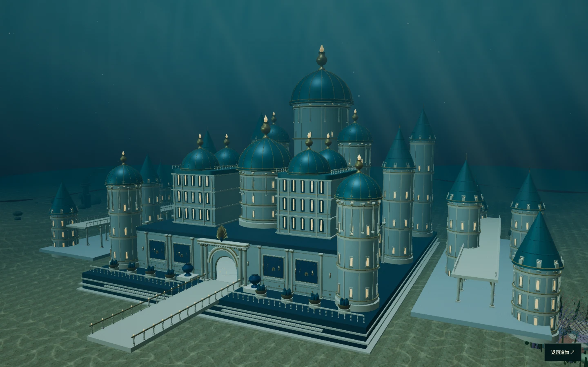

> 这是实时 Three.js 互动作品，不是预录视频。公开体验不启用付费模型；程序化三维、语言模型与 AI 视频能力明确区分。

## v0.14.2：选择目的地，沿安全航路抵达

在「海域与奇观」选择 **沿途漫游**，或使用海图的「沿途航行」。手机可从「探索工具」进入。

- **先规划，再出发**：对建筑、海床和观察者体积检查通道；开阔水域先尝试宽阔航路，复杂位置使用有预算的分帧搜索。不是关闭碰撞或改成瞬移。
- **途中也会避让**：预测附近生物的运动，减速、绕行或暂时等待；流式加载的新建筑会触发路线复核。真实移动到目的地才报告抵达，不再用动画倒计时冒充进度。
- **保留门洞逻辑**：宫内按真实长廊和门洞行进；从房间选择远方海域，先经正门离开再继续。经过中间路点保持低速，最终抵达缓缓减速。
- **控制权随时可取回**：拖动、WASD 或触屏方向键接管时取消自动路线；暂停冻结导航。界面显示规划、绕行、等待及剩余路程，不显示虚假的固定时长百分比。

自动导航是有限范围的几何规划与运动预测，不是全局最优或通用自主驾驶。通道被永久封死、终点位于实体内部或长时间没有安全进展时，会留在安全处解释原因；不会穿墙，也不会无限重试。详见 [自动航路验收](自动航路验收.md)。

## v0.14.1：让生物有空间，让游动有惯性

- **重新分区，而非清空海洋**：巨鲸与古鱼在更高、更远的水层巡游，海龟、人鱼和鹦鹉螺使用错开的近礁路线。两套环境鱼群各分成六条疏密有别的带状活动区，保留 560 条圣城游鱼和 565 条生态鱼的初始数量；捕食仍会改变后者的存活数量。
- **碰撞范围贴近形体**：古鱼、海龟、鹦鹉螺改用覆盖躯干与附肢的复合球体，不再将展开的鳍连同周围空水域包成一个巨球。接近时提前偏航，硬碰撞与建筑阻挡仍作为最后一道保护。
- **不再横着漂、忽快忽慢**：自然生物的朝向根据修正后的真实移动方向缓慢调整，限制加速度和转向速度；小于一厘米的连续位移不再被当成静止。鱼群保留邻近间距，转向依据实际游动方向。
- **计算与显示分开**：鱼群避让按 20 Hz 固定节奏更新，位置与朝向在每个显示帧插值；并非把画面锁到 20 FPS。暂停保留插值后的姿态，大生物和手动控制仍逐帧更新。

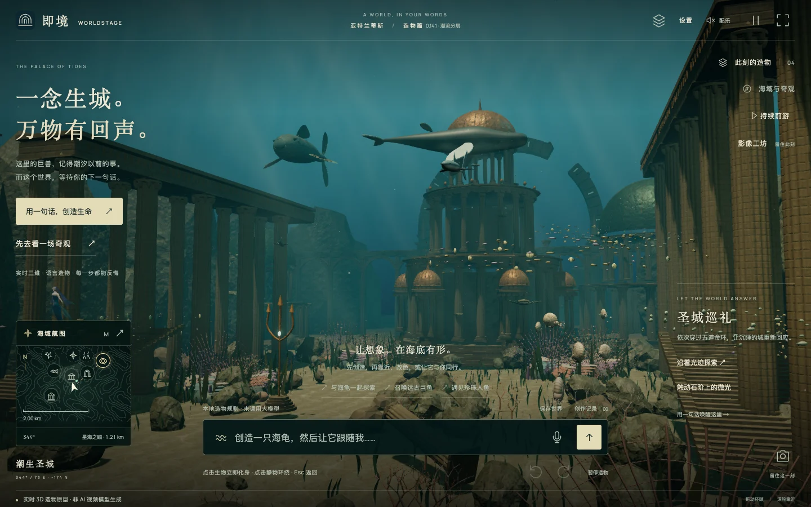

新建世界采用新的默认鲸鱼位置；不会擅自覆盖已有的本机存档。229 项自动测试通过，生产页面验证了直接点击鲸鱼进入第一视角、WASD 移动、暂停与手机布局。仍是有边界的实时原型，不承诺任意数量造物、所有碰撞情形或所有设备稳定 60 FPS。详见 [潮流分层验收](潮流分层验收.md)。

## v0.14.0：先完成一次创造，再探索整片海

首页点击 **「用一句话，创造生命」**，或在探索工具中打开「初次造物」。这是一条可随时退出的五步引导，不是自动播放的演示：

1. 填写并发送造物描述，真实创建一只生物；只填写示例不计进度。
2. 对同一个对象改色，身份、关系和其他造物保留。
3. 撤销这次改色，不移除刚创造的伙伴。
4. 直接点击画面里的伙伴进入第一视角；不弹出角色选择框。靠近按钮只调整镜头，不替用户点击。
5. 返回自由探索并确认保存。只有浏览器存储写入成功，才显示引导完成。

引导不自动导航、不自动发送、不保存任务行为，不重置世界。误点其他动物、修改其他物品或存档失败不会伪造完成；删除目标会回到第一步。可以关闭引导继续探索；重新载入已有世界时关闭当前引导，不把旧进度冒充新操作。

**加载与流畅度**：入口先显示可重试的界面壳，再动态载入三维。房间信息、试炼文案和视角按钮不再静态引入建模代码；四个加载阶段分别对应引擎、纹理、世界构筑和首帧。分包是职责隔离，不等于减少三维资产总下载量，三维主包仍有体积警告。

默认开启「自适应渲染分辨率」：持续慢帧后逐级使用所选画质的 90%、80%、72% 渲染比例，持续有余量才逐级恢复；首次预热、暂停和导航过渡不作为降级依据。保留碰撞、生物数量、动画与界面清晰度。设置里可关闭，立即恢复所选固定画质；不宣称所有设备稳定 60 FPS。

**交互修正**：手机方向键避让代入面板的实际高度；引导说明不遮住画面中的生物点击。影像工坊纳入统一的面板关闭、Esc 和键盘焦点管理。能力说明纠正过期的“没有碰撞／未使用 Blender／声音全部合成”等描述。

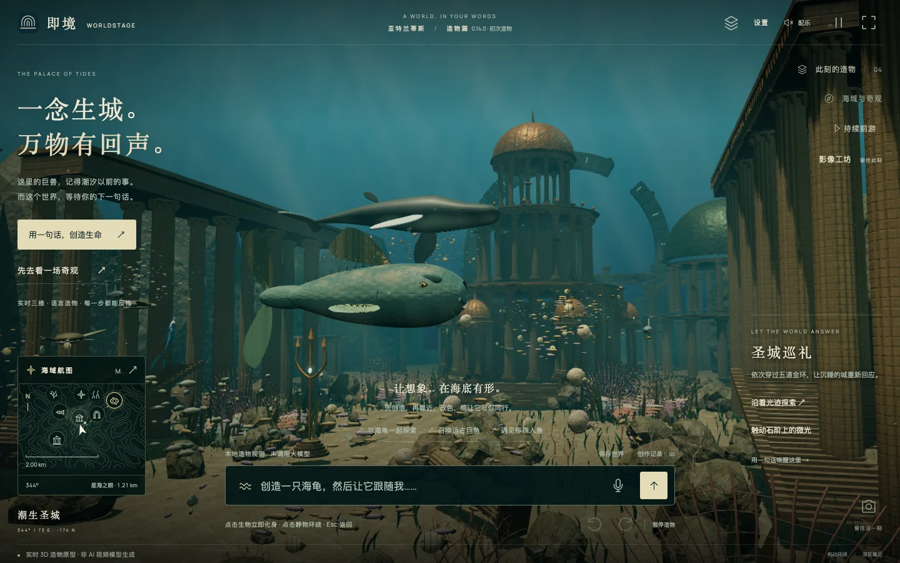
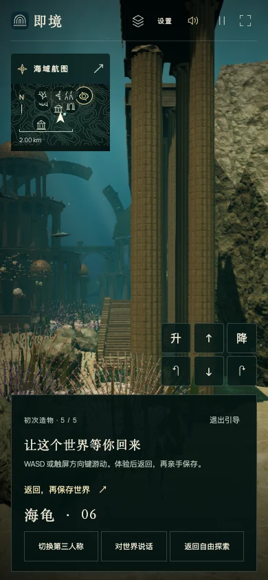

[初次造物验收：实测、取舍与未完成边界](初次造物验收.md)。本轮 219 项测试通过；性能记录不是所有设备的承诺，也不冒充真实用户验证。

## v0.13.0：让宫城有生活，也有可以回应的故事

先前只有宴会厅，没有独立餐厅，也没有内花园。本版保留原来的五间房，在长廊末端增加两处有实体门洞、家具和碰撞的空间：

- **潮汐内花园**：连续承重基座、青铜肋骨透光拱顶、贝砂种植池、有根海草、网脉珊瑚、贝壳休憩座与留声贝。海草使用共享时钟轻摆，暂停与降低动态均有效。
- **珊瑚餐厅**：三张独立双人圆桌、六套餐具、雕脚软包座椅、珊瑚插饰、叠放贝瓷碟、银壶备餐台与观景窗。不是把金枝宴会厅改个名字。

门口增加可点击中文门牌；输入「去花园」「去餐厅」也会沿长廊前往，不能穿墙或从任意外墙进入。

**支线“未赴之约”**：接待厅点邀约铭文 → 接受邀约 → 花园轻触守园人的留声贝 → 餐厅为远行者留席 → 回到铭文回应邀约。花池、留名贝与铭文的发光随进度缓慢改变，重复选择不会叠加刷取进度。

书记官、守园人、侍宴者以器物记忆提供文字分支；人鱼、鲸、海龟、鲨鱼、蝠鲼也能继续追问。点击生物仍立即进入其视角，不用先选角色；「交谈 / 阅读」是代入后的可选操作。点击关键器物仍保留环绕视角，同时打开手记。Esc 先关闭阅读，再退出化身。

**阅读与边界**：六则札记分别讨论环形城市、财富与节制、宫廷果园、会饮、迎客和残篇；来源为《克里提亚篇》《会饮篇》《奥德赛》第七卷的公开英译本。原文来源按钮不自动联网。故事明确标注原创，海洋生物台词标注神话拟人，不冒充动物语言翻译、考古结论或开放式 AI 对话。新对话没有中文合成朗读；歌唱与鲸鸣调用已有音频，并尊重静音。

**手记保存**：默认只存在于本次浏览。手记底部可手动保存、读取或确认删除；只存有限故事编号、选项和进度，不存用户输入、录音或模型密钥。它与原来的「保存世界」是两个明确独立的操作。

**入口**：宫城导览中的「潮汐手记」、紧凑界面的探索工具、代入后的「交谈 / 阅读」，或直接输入「打开潮汐手记」。场景反馈只有在对应房间／生物附近、满足前置步骤后才允许执行；远程翻阅不会自动完成任务。

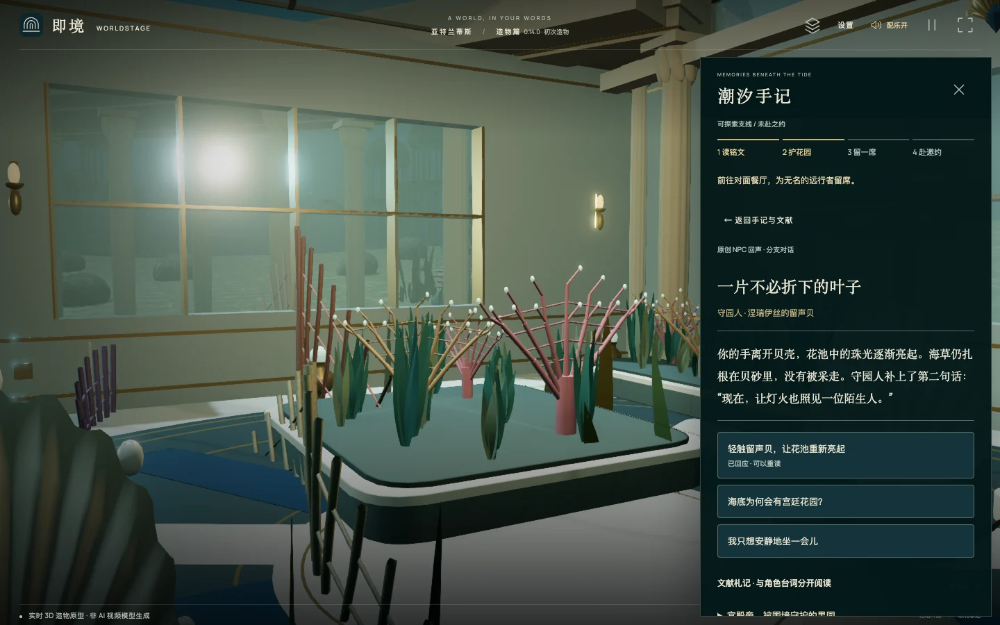

## v0.12.0 历史记录：从塔楼城堡，改为海神的都城

外观以已核对的 KitBash3D《Atlantis》三维建筑参考为方向，重新组织尺度与空间，而不是继续增加穹顶和尖塔。中央神殿用巨型凹槽石柱、三角山墙、深拱券与青铜屋面形成主轮廓；两座较低的侧殿、层叠石台、新月前庭和弧形柱廊构成连续的宫城。岩礁承托台基，外廊内部和上层神殿中轴可自由游入。

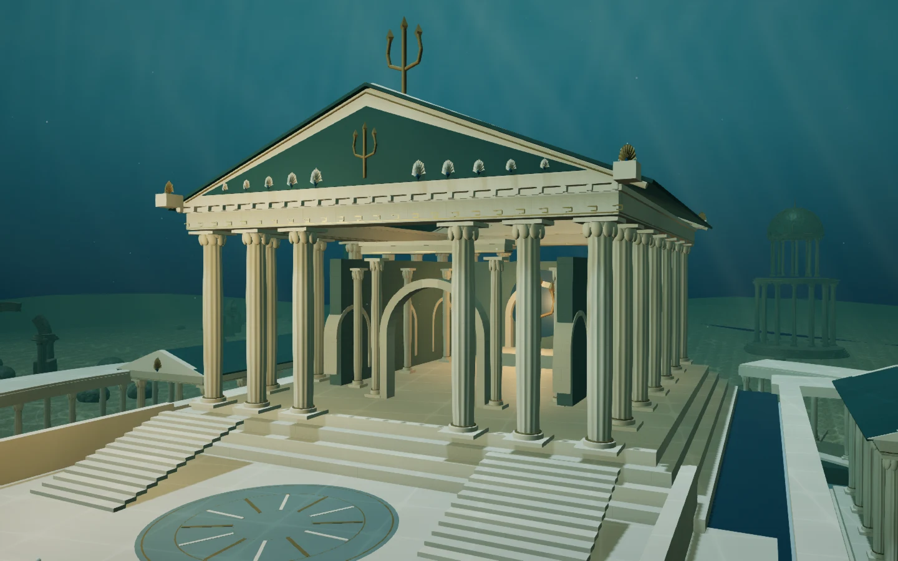

象牙色石材、旧青铜、铜绿和局部暗金各有分工。台阶、柱础、柱头、檐梁和屋面具有实际几何；石缝、沉积色差与缓慢焦散固定在建筑本地坐标。光线集中在主殿与祭坛，使用过滤后的结构投影，不把全部外墙做成发光灯带，也没有把陆地瀑布或树木搬入水下。

**可进入与可操控**：点击正门光环仍直接进入珍珠接待厅。客厅、宴会厅、寝宫和会所的门洞、家具、导览与连续路线保留；外廊石柱、顶板和礁岩有实体阻挡。小地图标记同步改为神殿轮廓。手机横竖屏导览与小地图不重叠，全屏观看继续可用。

**渲染边界**：共享几何与实例化仍是主要方式。室内墙壳和外部宫城分开绘制；被不透明房墙挡住的外景不绘制，从正门或后窗能看到外部时恢复，碰撞不会随隐藏删除。降低动态时停止新石材焦散，外部暖光平滑过渡，不跟着镜头漂移。

本机 Chrome、均衡画质、1440 × 900 的一次定点测量：外景约 60 FPS，接待厅约 47 FPS，宴会厅约 38 FPS。复杂室内尚不能保证稳定 60 FPS；手机只完成浏览器视口与全屏验证，不宣称所有安卓或 iOS 真机均已验证。

这是本项目原创程序化模型，没有购买或导入 KitBash3D 的模型、贴图，没有用参考图片冒充运行画面，也不是考古复原。本轮没有新增 Blender 雕塑资产。193 项自动测试通过，详见 [海神圣域验收](海神圣域验收.md)。

## v0.11.0：让宫殿有真正的工艺层次

不再把重复圆筒塔、整面金色和发光细线当作奢华。主殿和迎宾塔改为有曲率的铜绿穹顶，配以鎏金肋线、柱廊、檐口齿饰与三重入口石拱；外围保留较纤细的尖塔，建立主次轮廓。入口两侧加入珐琅礼瓶和礼仪阶梯，中央通行线保持开放。

室内以象牙石、海蓝珐琅、旧金和酒红织锦分工：墙面有嵌板、墙裙、线脚和立体贝冠；柱子有凹槽与叶饰柱头；头顶是分层藻井和三层珠链吊灯，脚下是潮汐纹章与石材拼花。五间房分别保留接待、会客、用餐、寝居和观海功能。


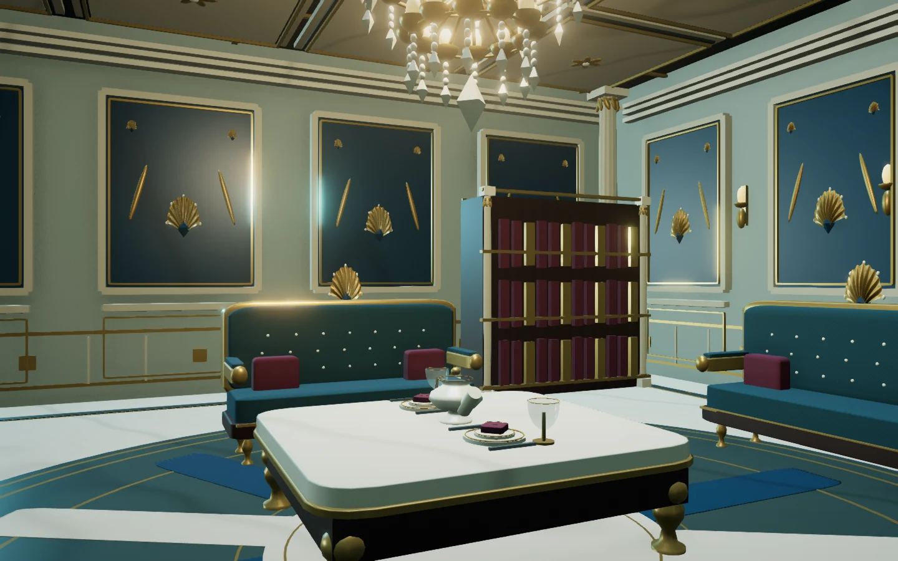

家具不再只有方盒轮廓：蓝绒座椅加入软包、珠钮、扶手、抱枕和车雕腿；宴会长桌有桌旗、双层餐盘、餐巾、高脚杯与树形桌灯；寝宫使用四柱床、褶皱帷幔、贝冠床头和梳妆香瓶，吊灯避开床冠；会所增加有层次的酒柜、观海窗与会客席。

**交互与渲染**：点击门洞仍连续入室，不增加选择确认框。批处理后的饰件保留独立名称与近看尺度；按门洞和视野剔除不可见室内细节，但不移除实体阻挡。共享几何、按材质实例化，并在首次靠近时加载房间。石材纹理固定在宫城本地坐标，不随浮动原点漂移；暖光停留在吊灯位置，房间之间平滑过渡，而不是跟着镜头照射。

本轮是程序化实时模型的精修，不声称是摄影级扫描资产，也未新增 Blender 建模或购买外部宫殿模型。五间房可进入，不代表每座塔楼的每一层均可探索。详细实测、性能边界和截图见 [宫城精修验收](宫城精修验收.md)。

## v0.10.1：让珊瑚闪耀，让群星奔涌，让天门回应

**虹珊瑚海**在平静时也保留彩色光晕：31 片海扇附着 992 个珠光闪点和 124 处柔光，粉晶、冰蓝、香槟金与薄荷青沿枝脉和轮廓流动。输入 **「唤醒虹珊瑚海」**，蓄光后的快速绽放带动各簇高光逐层亮起，再自然消散。闪点随海扇一起摆动，保留深度遮挡；新增光晕合并为一项绘制，不增加逐点灯源或更多悬浮粒子。降低动态模式减弱辉光并关闭闪点追逐。

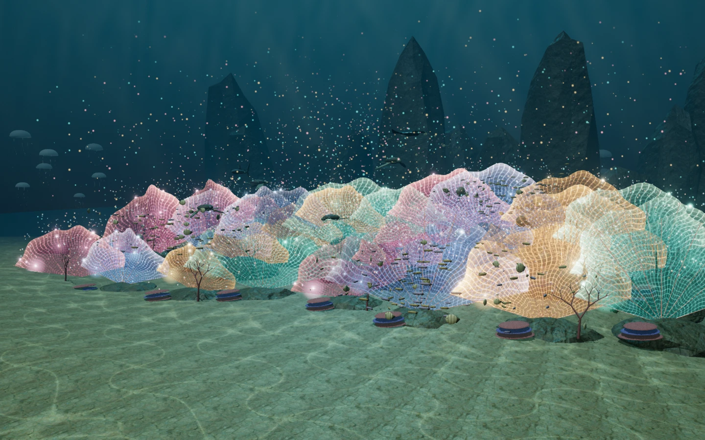

输入 **「唤醒星海之眼」**：1,500 条鱼先收束，约 1.8 秒后沿三组倾斜星环迅速加速，峰值约为原巡游速度的 8 倍。银蓝与暖金星光沿流向闪耀，300 道短星轨直接记录鱼群经过避让后的实际位置；约 18 秒后归于静流。没有添加海底烟花发射器，也没有用乘大时间的方式让鱼群突然跳位。降低动态模式保留构图、限制加速并取消追逐式闪耀。


天门不再使用设备中文朗读。在输入框写 **「回声之门：沉睡的光」**、**「回声之门：海洋的记忆」** 或 **「回声之门：守护者」**，会按主题匹配七段本地合成的低沉古希腊语男声，经过胸腔均衡、慢速处理、殿堂混响与延迟；文字只在本地匹配，不上传输入。音色缺失时明确提示，不偷偷改回中文。语音启播不再等待全部管弦采样下载。

**语言边界**：使用古希腊语文本、eSpeak-NG 的 `grc` 音素规则和男声声学模型，不再用现代意大利语读拉丁文。天门开场引用《荷马颂歌·致波塞冬》第 6 行，其余为本项目仿古短句；是合成近似发音，不是经专家认证的历史重建，也不是任意输入的逐字翻译。中文仅作字幕释义。手机和静态页面使用同一套 `grc-*.mp3`，不依赖 macOS 系统语音包。顶部标记 `0.10.1 · GRC` 可区分旧页面。

[星轨与古语更新验收](星轨与古语更新验收.md)。新克隆项目的完整音频制备新增 `uv` / Python 3.12 依赖；已备好旧配乐时，单独运行 `npm run audio:gate` 即可。

## 第十版：走进潮冠宫城

海图新增第八处地点 **潮冠宫城**。主塔、两翼宫楼、外围尖塔、拱廊、层叠台基和暖色窗灯组成一座海底宫城；它不是贴在背景上的城堡图片。

从正门进入，五间房室由真实门洞和中央长廊连接。点击门边光环即可进入，或用输入框和可收折导览前往；无需另选角色视角。途中可以拖动环顾、用方向键接管移动，墙、门框和主要家具仍保留实体阻挡。

| 房室 | 实际可见的细节 |
| --- | --- |
| 珍珠接待厅 | 双侧迎宾台、围坐长椅、珍珠吊灯、地面镶金纹章 |
| 蓝绒客厅 | 围合沙发、茶几、贝瓷茶具、藏书柜 |
| 金枝宴会厅 | 十二席长桌、餐盘、高脚杯、刀叉、桌灯与边柜 |
| 月贝寝宫 | 四柱帷幔床、床头雕饰、床柜、梳妆镜与更衣柜 |
| 观海会所 | 吧台、瓶架、会客座席与真实观景窗洞 |


**体验路线**：海图选择「潮冠宫城」→ 点击正门光环或输入「进入城堡」→「去客厅」→「去宴会厅」→「去寝宫」→「去会所」→「退出宫殿」。从建筑背面不能穿墙进入，先回正门。

同一版还加入九只错峰跃水的海豚、连续上浮可到达的夕照水面、珊瑚蓄光后的快速径向盛放，以及宫城／夕照两套配乐。角色移动的 A/D 改为转向，镜头随运动朝向平滑跟进。

人鱼头部与手部已经实际通过本地 Blender / bpy 处理官方基础网格，再导入实时场景；不是只声称调用建模工具。[网格来源与授权](src/assets/PROVENANCE.md)记录了具体 CC0 资产与处理方式。海龟盾片、鲸鱼胸鳍／背鳍及独立锤头鲨轮廓也有调整，但这些仍不是参考图级电影资产。

**边界**：当前可入室内是上述五间房，不是每一座尖塔的每一层均可进入；尚无独立厨房、浴室、仆役区，也没有开柜、拿取餐具或完整生活模拟。v0.10.0 的系统中文语音失败记录保留在历史验收中；v0.10.1 已用上述本地古希腊语男声音色替代。

[本轮实测与剩余项](宫城与生命更新验收.md) · [历次需求核对](需求核对.md)

## 第九版历史记录：让生命有重量，让世界有回应

### 0.9.1 性能修复

碰撞查询改为三维空间索引，复用计算缓冲区；避障后的真实位置不再被下一帧脚本轨迹覆盖。人鱼长发与尾部保留原来的逐帧形变，改用解析法线，避免每帧重算全部三角面。没有减少物种、粒子、渲染分辨率或取消实体阻挡。

Apple M1、1440×812、均衡画质、Chrome 无分析器的两轮正式构建对照：旧版约 30–37 FPS，本版约 47–48 FPS。仍有 33 ms 帧，不承诺稳定 60 FPS；详细条件与回归结果见 [性能验收](性能验收.md)。

鲸鱼的身体、尾部与胸鳍使用随模型比例变化的组合碰撞体；柱、墙、台基与礁石分别阻挡移动，而不是把整座神殿封成一个透明盒子。生物会避让、鱼群会逃逸，操控巨鲸时不能再直接穿过建筑。碰撞是带分段检测的实时运动约束，不是科研级水动力或软体模拟。

人鱼重新制作了面部、蓝紫长发、修长尾部、半透明尾鳍与关节动作。她会巡游，也会唱有法语歌词的歌曲；远处的座头鲸录音间歇响起，并与歌声错开。没有使用语音朗读或无词音垫冒充唱歌。


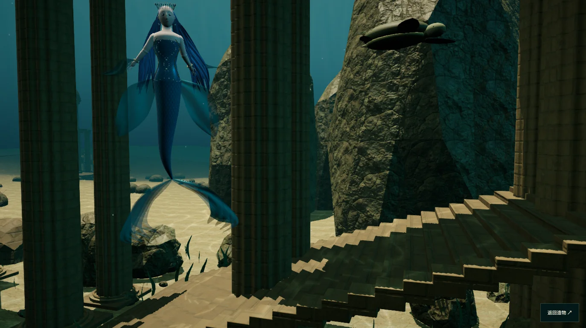

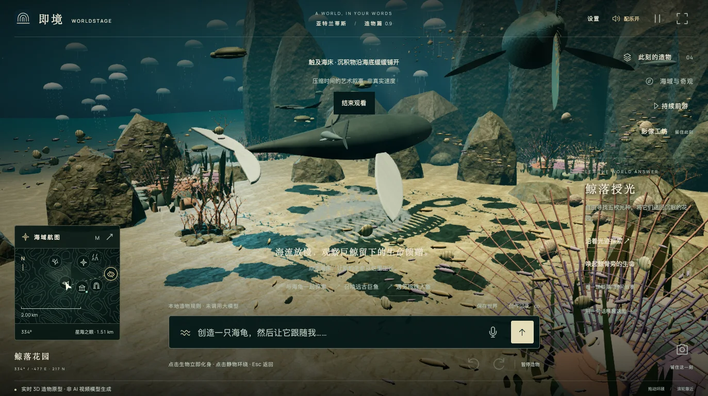

手机横竖屏把次要操作收入工具抽屉，输入框跟随软键盘抬升；全屏不可用时保留纯净观景和主屏幕打开提示。桌面预览跟随真实窗口大小，不再固定成大于屏幕的画布。

### 奇观继续拥有自己的音乐

抵达天门，低弦与圆号缓缓入场；唤醒遗迹，铜管与鼓声随光的盛放加入。当前九套原创编曲使用公开器乐录音采样，音乐、交互与视觉阶段相互响应，而不是整片海域只循环水流声。

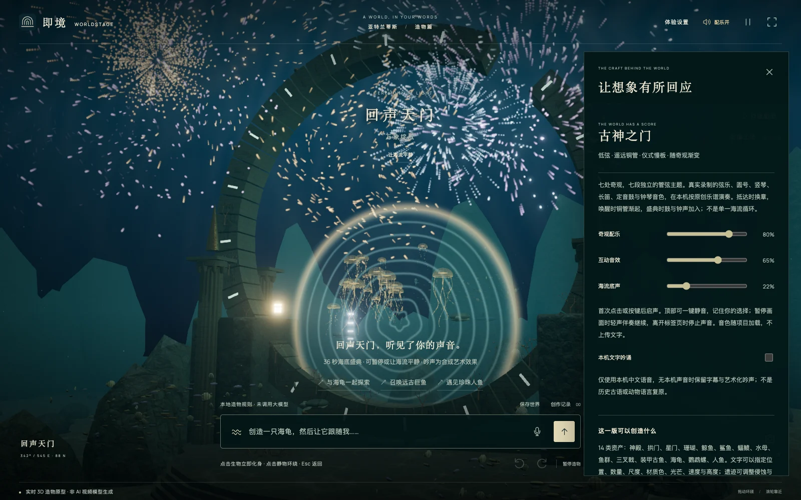

[历次需求完成情况与剩余边界](需求核对.md) · [本版验收](验收说明.md) · [素材许可](素材与许可.md)

## 从这里开始

本地交付目录已备好音色。新克隆 GitHub 源码时，先安装 Node.js 24 和带 `libmp3lame` 的 FFmpeg，运行 `npm ci`、`npm run audio:prepare`，再 `npm run dev`。制备脚本按清单从公开上游下载，器乐核对 Git blob 标识、角色录音核对 SHA-256，去除元数据并统一音量；不需要密钥。音频二进制因外发脱敏门禁暂不纳入 Git，未备齐音色时开发与构建会明确报错，而不是静默缺失配乐。

1. 按 **M** 打开海图，看地标图标、当前位置和两地距离，选择回声天门并快速抵达。
2. 首次操作即启声。输入 **「唤醒回声天门，召唤鲸鱼」**，听《古神之门》的铜管与深鼓逐渐加入；顶部 **配乐** 可静音。
3. 直接单击画面生物进入第一人称，再用当前角色开始探索；WASD、Q / E 移动，实体会阻挡去路。完成路线后光沿海流和枝脉扩散，不在海底发射烟花。
4. 返回自由探索，输入 **「创造一只海龟，然后让海龟跟随鲸鱼」**，再改色、改速或撤销。
5. **单击画面中的生物，直接进入第一人称**，无需旁边确认框；单击静物直接 360° 环绕。WASD 游动，Esc 返回。离开前手动 **「保存世界」**。
6. 输入 **「让人鱼唱歌」**；或靠近人鱼聆听。这里使用德彪西《Spleen》的女高音与钢琴录音片段，有法语歌词，不是中文原创歌曲。
7. 前往鲸落花园，输入 **「观看鲸落」**，看沉降、沉积物与生态接续。整个过程为 76 秒的艺术时间压缩，不是真实生态时间尺度。

示例按钮只填入，不自动执行。文字输入支持有限的本地规则，不承诺任意一句话都能理解；未支持的请求会明确提示，不假装成功。

## 三幕奇观

### 星海之眼 · The Eye of a Thousand Tides
巨鲸穿过旋游鱼群，残缺的铜金天球仪环绕外侧。微光、鱼群与金属环各有自己的运动节奏。

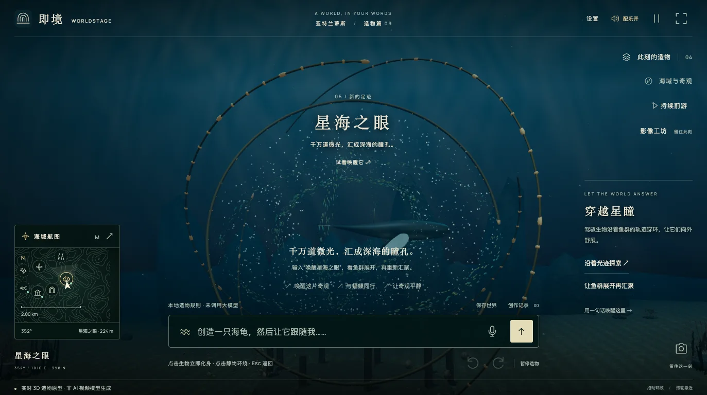

### 虹珊瑚海 · The Garden of Refracted Light
半透明网状海扇层层展开，光沿枝脉传递，而不是把整个画面照成白色。


### 深渊光泉 · The Fountains Beneath the World
暗色烟囱与上涌粒流形成垂直构图。金色核心、细长光丝和冷色深海保留明暗差异。

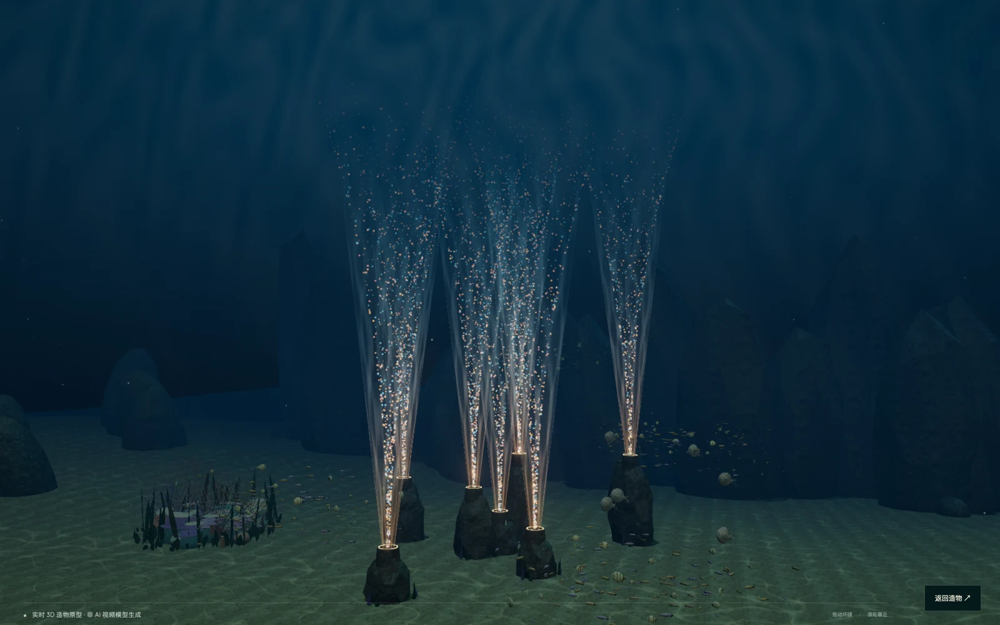

## 让世界真正回应

- **混合架构**：规则规划器、显式世界状态与实时渲染器分工。文字和主要按钮经过相同校验，下一条指令读取执行后的状态，详见 [混合世界架构](混合世界架构.md)。
- **海域小地图**：八种地标图标、朝向、发现足迹、缩放拖动、两点测距和导航。距离采用同一全局坐标系的水平直线距离，不是绕障碍的航程。
- **角色代入**：可拾取的生物支持第一／第三人称与移动；静物围绕点击位置观察。批量合并的建筑不代表每块砖都有独立身份。
- **可重复试炼**：七处地点共享三类玩法规则——依序穿环、自由采光、呼吸节拍；四种试炼生物，本次会话计时与最佳成绩。
- **自然光的回应**：枝端珠光与轮廓辉光沿珊瑚扩散，鱼群在星海之眼形成三组倾斜、进动的星环；“花火”只参考规模与层次，不做庆典。天门将受限文字呼唤匹配到本地古希腊语男声片段，不调用设备中文朗读，也不生成任意新物种。
- **生命的声音**：人鱼有词歌曲与远处座头鲸录音分时播放，位置变化带来声像与音量变化；暂停、静音、离开标签页和素材失败有明确处理。
- **实体与生态**：建筑分部件包围体、长体生物组合球体、分段移动检测、海床限位与近域避让；灰礁鲨捕获实际游鱼，饱食休息，鱼群有限迁入。不是跨世代自然选择模型。
- **连续创造**：14 类资产，包含建筑、珊瑚、鲸鱼、灰礁鲨、蝠鲼、水母、鱼群、装甲古鱼、海龟、鹦鹉螺与人鱼。
- **稳定身份**：改变颜色、大小、速度和高度，不重新生成另一个对象。跟随与环绕互斥，支持释放、撤销和重做。
- **连续运动**：躯干到尾部的传播波、法线同步、鳍与下颌的次级运动；行为切换保留当前位置和动量。
- **独立材质**：本地生成皮肤／鳞片数据纹理，分别控制色素、表面凹凸与粗糙度；鲸鱼不套用鱼鳞纹理。
- **开放探索**：四处遗迹、三幕奇观、潮冠宫城和夕照海面处于同一个连续世界，地形按需加载并复用缓存。
- **可恢复的世界**：手动保存到当前浏览器，只保存造物、关系、视角与探索足迹，不保存输入原文。
- **影像工坊**：截图与 10 秒原生三维录像；不会录制桌面、摄像头或麦克风。


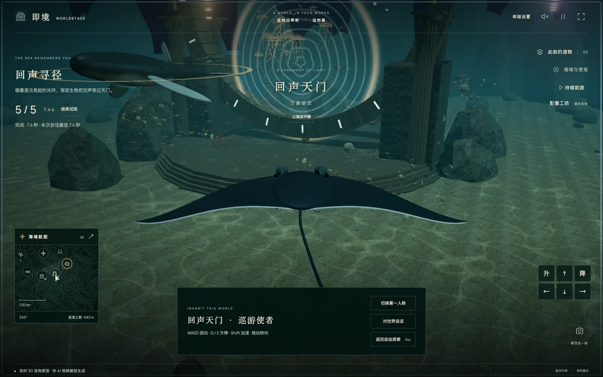

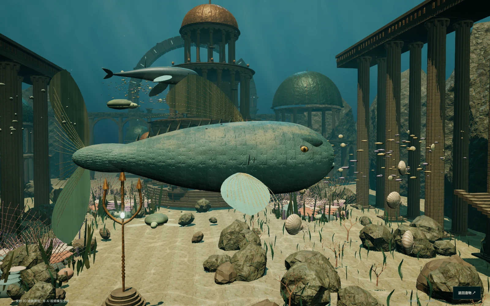

## 操作

| 操作 | 方式 |
| --- | --- |
| 环顾 / 靠近 | 拖动 / 滚轮；触屏拖动与缩放 |
| 移动 / 升降 | WASD 或方向键 / Q、E |
| 加速 / 持续航行 | Shift / 「持续前游」 |
| 聚焦输入框 | `/` |
| 指认对象或位置 | 点选造物 / 点击近处海床 |
| 海图 / 测距 | M；小地图展开后选择两个地点 |
| 进入角色 / 返回 | 单击画面生物立即第一人称 / Esc |
| 代入时对话 | 「对世界说话」或 `/`；Esc 先收起对话 |
| 暂停 / 继续 | 顶部暂停按钮；画布聚焦时按空格 |
| 音乐 / 音效 / 海流 | 首次交互启声；顶部一键静音；体验设置分别调音量 |
| 纯净观景 / 返回 | 顶部全屏样式图标 / Esc |

暂停画面不再切断所有背景声：配乐降低音量继续，鼓层退下；切到其他标签页才挂起音频。手动静音会被记住，不会被下一次点击取消。音乐使用本地分发的 VSCO 2 CE 乐器录音采样，按原创 16 小节乐谱实时编排；来源与 CC0 文本见《素材与许可》。不需要音乐账号或付费接口。

画质可切换「精细、均衡、流畅」。支持系统降低动态偏好与手动设置。公开链接在不同设备上独立存档，清理浏览器数据会删除该设备的存档。

<details>
<summary>查看移动端运行画面</summary>


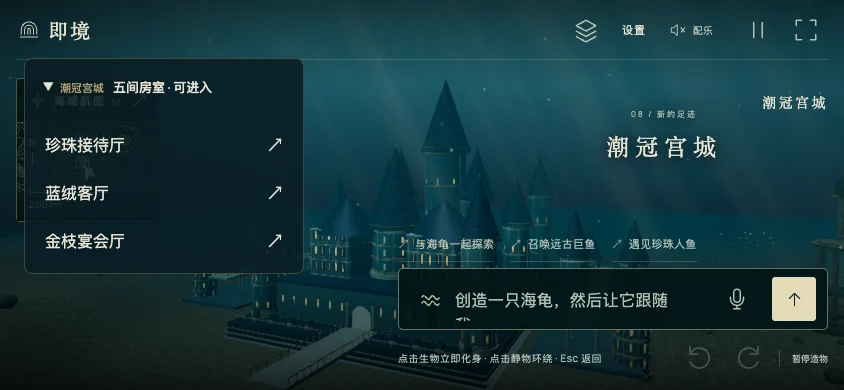

桌面浏览器触屏视口模拟；不作为手机实机帧率证明。

</details>

## 本地运行

使用 Node.js 24.x；本地验收、工作流模板与 Vercel 构建固定在同一主版本。

```bash
npm ci
npm run audio:prepare
npm test
npm run build
npm start
```

服务默认只监听本机 `127.0.0.1:5196`。macOS 也可以在构建后执行 `zsh 启动体验.sh`。不要直接打开构建目录中的 HTML。

```bash
npm run dev
npm run textures
```

第二条命令重新生成本项目的皮肤数据纹理，不调用图像生成服务。截图来自实际运行画面，不是概念效果图。

## 部署与安全边界

`npm run build:public` 和 `vercel.json` 使用 Vite 静态构建，只发布 `dist/`，也支持子目录静态托管。公开站点的语言与视频配置显式禁用；本地 `server.js` 中的模型代理不会成为公开 API。私人环境文件、聊天记录与参考图不进入仓库或部署包。

Vercel 项目保留关联，`git.deploymentEnabled` 为 `false`，推送不会自动上线。按已审核提交手动发布：

```bash
npm test
npm run build:vercel
cd work/vercel-public
vercel deploy --prebuilt --prod --yes
```

发布前须准备完整音频、完成外发检查，并提交已审核的代码。`build:vercel` 要求干净的 Git 工作树，生成隔离的 `.vercel/output/static`，只复制静态产物，不包含源码、环境文件或服务函数；拒绝隐藏文件与符号链接，校验付费模型接口保持关闭。线上 `/release.json` 记录版本和源码提交，可与 GitHub 对照；`/api/config`、`/api/media/config` 返回禁用配置，其他 `/api/` 路径返回 404。

作品配乐、人鱼歌曲、鲸鸣与天门古语音频按作者确认的有限发布例外随网页公开，音频二进制仍不进入 Git。扫描器不能可靠检查音频，不将其表述为扫描通过；用户参考图、录屏、聊天与本机凭据不在例外范围。新克隆仍需 `npm run audio:prepare`。访客首次点击页面后启声，设备静音或浏览器限制可能需要手动开启。部署历史与验收边界见 [发布说明](发布说明.md)。

实际产品边界：最多 20 个可编辑造物；角色对话是有边界的预设回应，不是开放式 AI 对话。碰撞为保守的几何近似，可能在窄缝提前阻挡；不是完整刚体、水动力、软鳍接触或所有粒子的碰撞模拟。装甲古鱼和人鱼为幻想设计；v0.10.0 的头手加入 Blender 基础网格，其余主要是程序化资产，尚无完整人物蒙皮或电影级质感。混合工程架构不等于学习型 World Model。

### 手机在同一 Wi-Fi 访问

运行 `npm run build:public`，再运行 `npm run preview:phone`；使用终端显示的局域网地址。该服务仅分发构建后的静态文件，不开放模型或媒体代理。只在可信网络使用，关闭终端即结束；不是公网部署、账号登录或云同步。iOS/Android 浏览器可访问，但当前验收为桌面 Chrome 触屏模拟，未完成手机实机测试。

## 工程与验证

- `src/creation.js`：受限造物协议、事务与撤销。
- `src/creation-scene.js`、`src/swim.js`：状态到连续运动的映射。
- `src/creature-surface.js`、`scripts/generate-skins.mjs`：独立皮肤与凹凸细节。
- `src/ecology.js`、`src/wonder-scene.js`：分层生态与动态奇观。
- `src/endless-ocean.js`：地形流式加载与有界缓存。
- `src/world-memory.js`：最小化存档与严格校验。
- `src/world-planner.js`：规划、前置条件校验、统一执行和状态观察。
- `src/embodiment.js`、`src/tide-play.js`：直接代入、小游戏和自然光回应。
- `src/collision-world.js`：分部件静态碰撞、组合体形、分段检测与近域避让。
- `src/creature-audio.js`、`src/food-web.js`、`src/whale-fall.js`：有词歌声、鲸鸣、捕食与鲸落叙事。
- `src/sea-chart.js`、`src/chart-math.js`：实时海图和坐标投影。

验证记录见 [验收说明](验收说明.md)。产品背景与演示叙事见 [项目简介](项目简介.md)。

GitHub Actions 配置保存在 `.github/ci.example.yml`，尚未启用。使用具有工作流写入权限的账号将其移至 `.github/workflows/ci.yml` 后，可在推送和 Pull Request 时自动执行测试、公开构建及生产依赖审计。

## 素材与能力说明

几何、动画与数据纹理为程序化制作；音乐采用器乐录音采样，人鱼歌与鲸鸣采用有来源声明的公开录音。石材与岩石纹理来自 Poly Haven CC0；Manrope 使用 SIL OFL，Three.js 使用 MIT。音频因外发扫描格式限制不纳入 Git，源码提供来源、哈希和本地制备脚本。详情见 [素材与许可](素材与许可.md)。

可选模型接口的本地配置分别见 [语言模型说明](模型接入说明.md) 与 [视频接口说明](前沿视频接入说明.md)。它们是独立实验能力，不是公开站点的默认生成服务。
