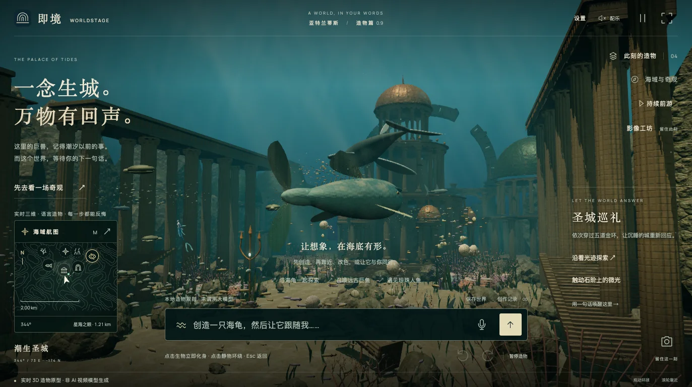
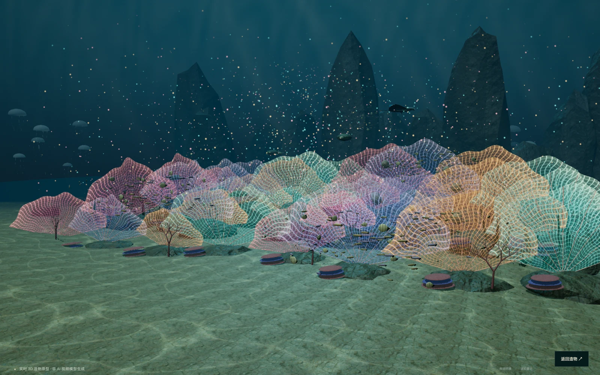
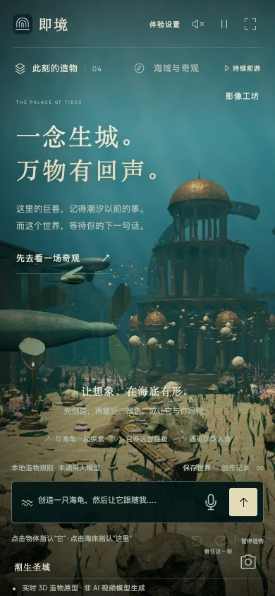

# 即境 · Worldstage

### 一念生城，万物有回声。

**一座可以用语言创造、修改与探索的神话海底世界。**

巨鲸穿过星海的瞳孔，光沿珊瑚的脉络流动，远古鱼群从沉没的柱廊间经过。你不只是观看者：创造一只海龟，让它与你同行；再改一改颜色、速度或尺度。世界保留对象的身份，也允许你反悔。



> 这是实时 Three.js 互动作品，不是预录视频。公开体验不启用付费模型；程序化三维、语言模型与 AI 视频能力明确区分。

## 从这里开始

1. 点击 **「先去看一场奇观」**，抵达星海之眼。
2. 输入 **「唤醒星海之眼」**，看鱼群展开，再重新汇聚。
3. 输入 **「创造一只海龟，然后让它跟随我」**。
4. 接着说 **「让它变成金色」**、**「让它游慢一点」**，或 **「撤销」**。
5. 在「海域与奇观」中继续探索；离开前点击 **「保存世界」**。

示例按钮只填入，不自动执行。文字输入支持有限的本地规则，不承诺任意一句话都能理解；未支持的请求会明确提示，不假装成功。

## 三幕奇观

### 星海之眼 · The Eye of a Thousand Tides
巨鲸穿过旋游鱼群，残缺的铜金天球仪环绕外侧。微光、鱼群与金属环各有自己的运动节奏。


### 虹珊瑚海 · The Garden of Refracted Light
半透明网状海扇层层展开，光沿枝脉传递，而不是把整个画面照成白色。



### 深渊光泉 · The Fountains Beneath the World
暗色烟囱与上涌粒流形成垂直构图。金色核心、细长光丝和冷色深海保留明暗差异。


## 让世界真正回应

- **连续创造**：13 类资产，包含建筑、珊瑚、鲸鱼、蝠鲼、水母、鱼群、装甲古鱼、海龟、鹦鹉螺与人鱼。
- **稳定身份**：改变颜色、大小、速度和高度，不重新生成另一个对象。跟随与环绕互斥，支持释放、撤销和重做。
- **连续运动**：躯干到尾部的传播波、法线同步、鳍与下颌的次级运动；行为切换保留当前位置和动量。
- **独立材质**：本地生成皮肤／鳞片数据纹理，分别控制色素、表面凹凸与粗糙度；鲸鱼不套用鱼鳞纹理。
- **开放探索**：四处遗迹、三幕奇观和近景视角处于同一个连续世界，地形按需加载并复用缓存。
- **可恢复的世界**：手动保存到当前浏览器，只保存造物、关系、视角与探索足迹，不保存输入原文。
- **影像工坊**：截图与 10 秒原生三维录像；不会录制桌面、摄像头或麦克风。


## 操作

| 操作 | 方式 |
| --- | --- |
| 环顾 / 靠近 | 拖动 / 滚轮；触屏拖动与缩放 |
| 移动 / 升降 | WASD 或方向键 / Q、E |
| 加速 / 持续航行 | Shift / 「持续前游」 |
| 聚焦输入框 | `/` |
| 指认对象或位置 | 点选造物 / 点击近处海床 |
| 暂停 / 继续 | 顶部暂停按钮；画布聚焦时按空格 |
| 纯净观景 / 返回 | 顶部全屏样式图标 / Esc |

画质可切换「精细、均衡、流畅」。支持系统降低动态偏好与手动设置。公开链接在不同设备上独立存档，清理浏览器数据会删除该设备的存档。

<details>
<summary>查看移动端运行画面</summary>



桌面浏览器触屏视口模拟；不作为手机实机帧率证明。

</details>

## 本地运行

需要 Node.js 20.19+；发布验收同时使用了 Node.js 24 环境。

```bash
npm ci
npm test
npm run build
npm start
```

服务默认只监听本机 `127.0.0.1:5196`。macOS 也可以在构建后执行 `zsh 启动体验.sh`。不要直接打开构建目录中的 HTML。

```bash
npm run dev
npm run textures
```

第二条命令重新生成本项目的皮肤数据纹理，不调用图像生成服务。截图来自实际运行画面，不是概念效果图。

## 部署与安全边界

`npm run build:public` 和 `vercel.json` 使用 Vite 静态构建，只发布 `dist/`，也支持子目录静态托管。公开站点的语言与视频配置显式禁用；本地 `server.js` 中的模型代理不会成为公开 API。私人环境文件、聊天记录与参考图不进入仓库或部署包。

实际产品边界：最多 20 个可编辑造物；不是物理生态模拟、任意形态生成器或科学复原。装甲古鱼和人鱼为幻想设计。当前未集成 World Model 或高斯泼溅，不将接口适配宣称为模型实测。

## 工程与验证

- `src/creation.js`：受限造物协议、事务与撤销。
- `src/creation-scene.js`、`src/swim.js`：状态到连续运动的映射。
- `src/creature-surface.js`、`scripts/generate-skins.mjs`：独立皮肤与凹凸细节。
- `src/ecology.js`、`src/wonder-scene.js`：分层生态与动态奇观。
- `src/endless-ocean.js`：地形流式加载与有界缓存。
- `src/world-memory.js`：最小化存档与严格校验。

验证记录见 [验收说明](验收说明.md)。产品背景与演示叙事见 [项目简介](项目简介.md)。

GitHub Actions 配置保存在 `.github/ci.example.yml`，尚未启用。使用具有工作流写入权限的账号将其移至 `.github/workflows/ci.yml` 后，可在推送和 Pull Request 时自动执行测试、公开构建及生产依赖审计。

## 素材与能力说明

建筑、生物、动画、皮肤数据纹理与音效由项目程序化制作。石材与岩石纹理来自 Poly Haven 的 CC0 资源；Manrope 使用 SIL OFL，Three.js 使用 MIT。详情见 [素材与许可](素材与许可.md)。

可选模型接口的本地配置分别见 [语言模型说明](模型接入说明.md) 与 [视频接口说明](前沿视频接入说明.md)。它们是独立实验能力，不是公开站点的默认生成服务。
