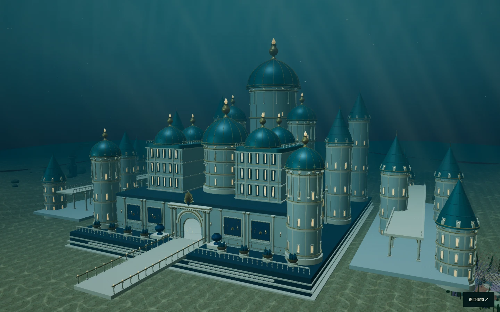
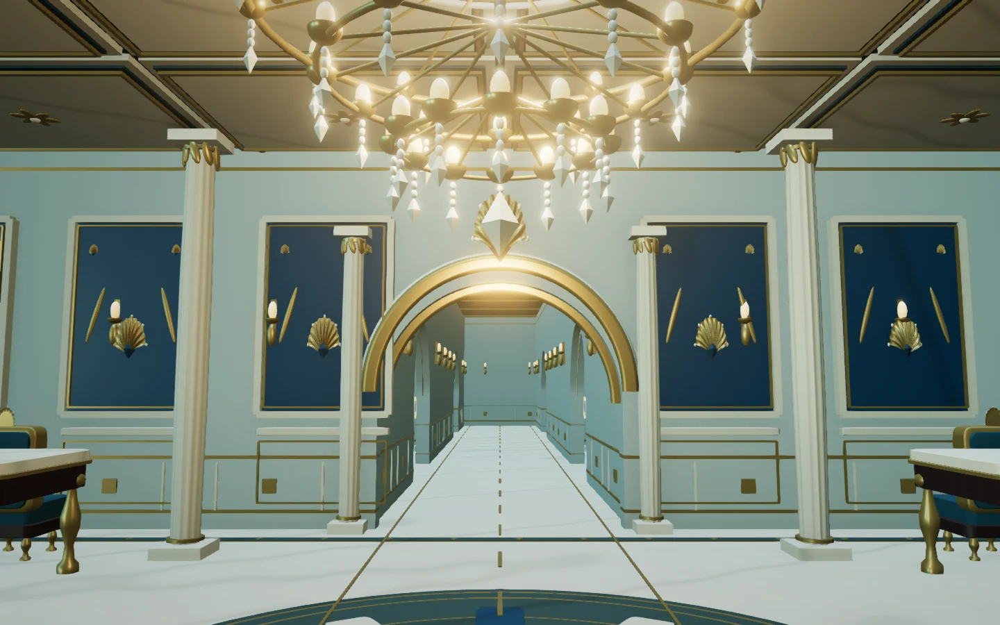
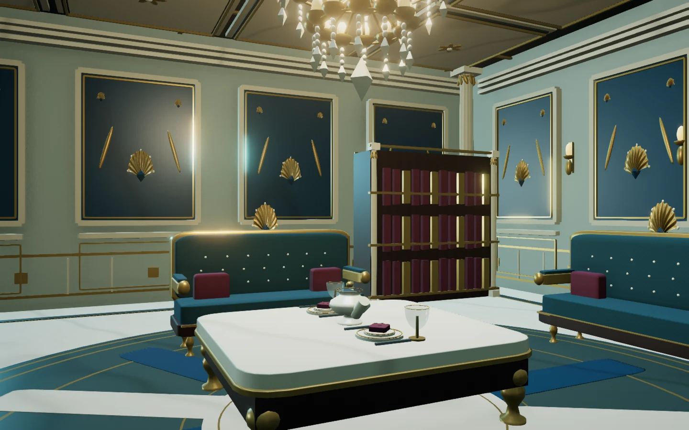
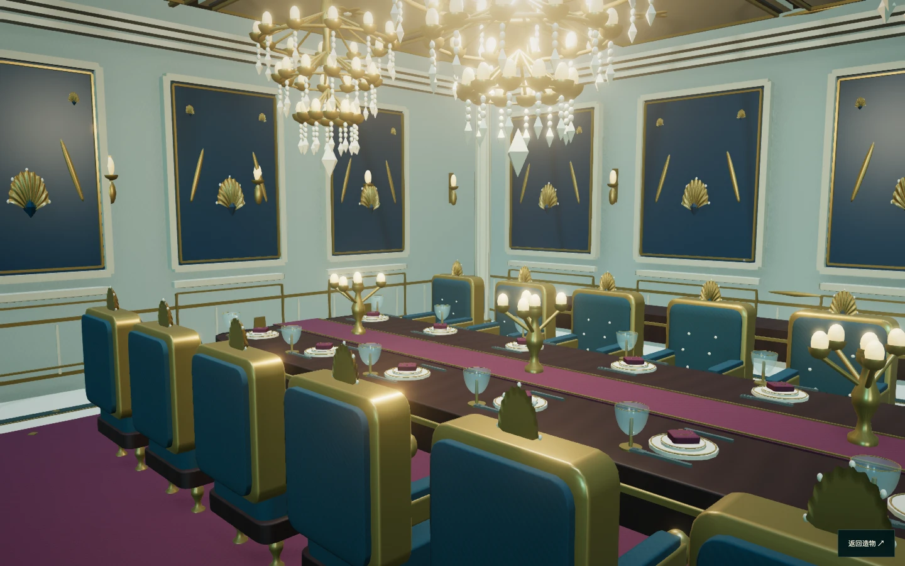
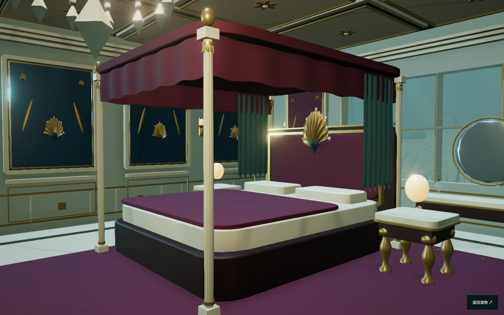
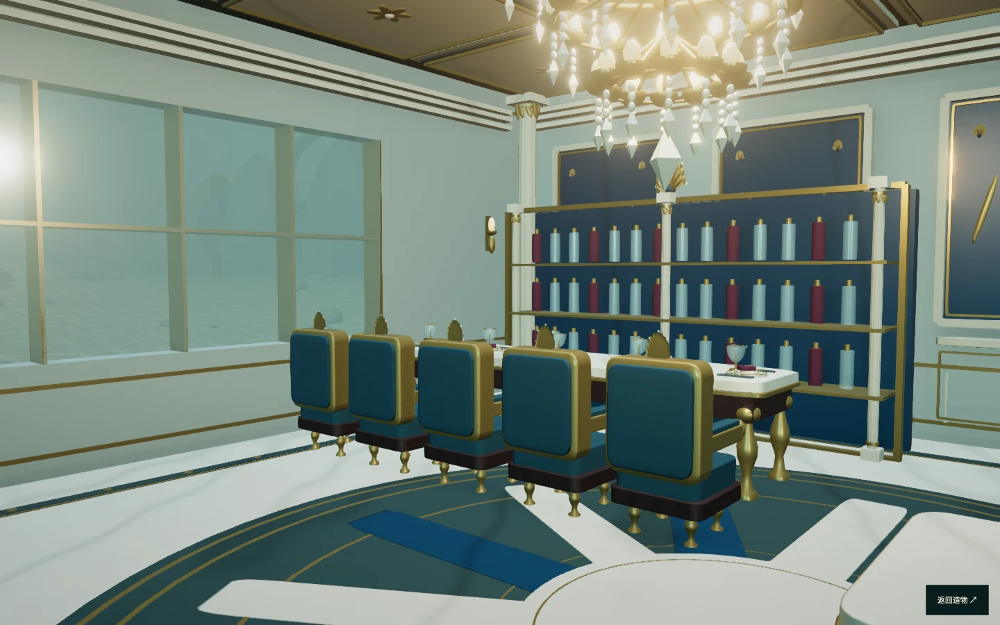

# 宫城精修验收 · v0.11.0

日期：2026-11-19。范围：潮冠宫城外观、五间室内、相关拾取与渲染。没有重新部署线上站点。

## 本轮实际修改

- 外观：主殿与迎宾塔使用铜绿曲面穹顶、鎏金肋线与环绕石柱；外围尖塔降低抢眼程度。入口增加三重雕花石拱、贝冠、檐口齿饰、珐琅礼瓶和分层台阶。
- 工艺：凹槽柱身、叶饰柱头、旋转成形栏杆和礼瓶、真正有起伏的贝冠浮雕。门洞内侧由阶梯状小方块改成连续曲面，保留分段碰撞约束。
- 室内：墙面嵌板、墙裙、分层藻井、石材拼花和珠链吊灯；五间房不再只靠白墙和金线区分。
- 家具：双面软包、珠钮、扶手、抱枕、车雕腿、贝瓷茶壶、桌旗、双层餐盘、餐巾、高脚杯、香瓶、藏书柜和有层次的酒柜。寝宫吊灯避开四柱床冠，防止穿插。
- 材质：象牙石、海蓝珐琅、旧金、铜绿、蓝绒和酒红织锦。程序石纹固定在模型本地坐标；浮动原点改变时纹理不游动。材质共享一张程序反射环境。
- 灯光：暖光锚定房间吊灯；移动和出入室内时平滑过渡，不再像手电筒一样紧跟镜头。
- 交互：点门直接连续进入；合批后每件饰物保留名称，并按被点击实例的尺寸环绕，而不是把整批家具误当成一个巨物。
- 手机：宫城导览与小地图分开摆放，室内隐藏重复的大标题；导览可以滚动，软键盘和工具抽屉出现时不争抢空间。

## 回归检查

`npm test`：186 项通过。新增 9 项宫城精修检查，覆盖：

1. 共享几何、有限坐标与实例名称。
2. 装饰不遮住接待厅及四个侧门的通行线。
3. 实例批次和三角形预算、反复访问不重复建模。
4. 浮动原点下的石纹坐标。
5. 墙体后不可见房间的门洞剔除。
6. 吊灯锚点与暖光平滑过渡。
7. 寝宫吊灯不穿过床冠。
8. 视野剔除和浮动原点下的房间包围盒；看不见的家具仍有实体阻挡。
9. 点击合批家具时的独立名称与近看尺度。

原有测试继续验证：五房及出入口的全部互通路线、门洞中央可点击、背面不能穿墙入宫，以及生物、音频与此前交互的回归。

真实 Chrome 中点击正门光环，实际经过入宫路线到达珍珠接待厅；不是仅通过脚本直接设置房间状态。桌面六个机位拍摄时未出现页面或着色器错误。

## 画面和性能边界

- 桌面实景：1440 × 900、均衡画质、DPR 1、Chrome 无头模式。
- 宴会厅静止机位、材质预热后连续记录 240 帧：平均约 40.9 FPS，帧时间中位数 16.7 ms，95 分位数 33.4 ms。拍摄期间各机位显示值约 39–58 FPS；不是严格同条件基线对比。
- 所有房间加载后的宫城几何合计约 181 万三角形、225 个网格对象；不是每帧全部绘制。房间按门洞和视野剔除，同一几何和材质按实例合批。碰撞代理独立于显示剔除，不能因转过头就穿过家具。
- 细化确实增加了几何负担，不能表述为比旧版更快，也不承诺稳定 60 FPS。首次加载和材质编译仍可能短暂停顿；低性能设备可使用已有「流畅」画质。
- 手机检查采用 Chrome 触屏视口模拟：390 × 844 和 844 × 390，画布与视口一致、无横向页面溢出。不是安卓真机 GPU 或 iOS Safari 的完整兼容认证。

## 实景截图

截图来自实际运行场景，没有用离线宣传图冒充实时效果。

## 脱敏与能力边界

本轮代码自动规则未发现明确敏感项。README 的版本数字、倍数和性能说明触发了通用规则，人工核对为作品技术信息；截图逐张复核为作品画面，未发现 EXIF/XMP/IPTC 元数据。性能日志中的长小数误触发号码规则，原始日志仅留在忽略的本地工作目录，对外使用取整后的说明。不能据此承诺绝对安全。

只发布代码、文档及上述实时截图，不上传用户参考图、录屏、凭据或工作目录。音频保持此前分发规则。

本轮为程序化实时建模精修，没有新增 Blender 工序、摄影测量或商业宫殿模型。五间房可进入，但仍不包括全部塔楼楼层、独立厨房浴室、开柜和拿取餐具；本轮也没有把其他历史需求全部标记为完成。
